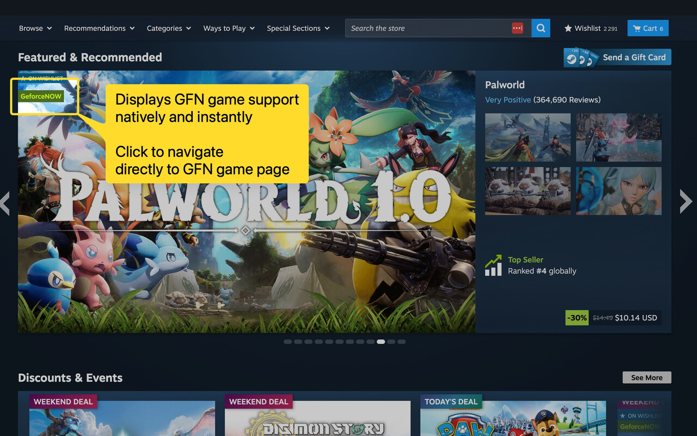

# GeForce NOW Checker for Steam

I built this after one too many trips between my Steam wishlist and the GeForce NOW library. The extension puts a small marker next to supported Steam games and opens the matching GeForce NOW page when you click it

It works on game pages, search results, deals, recommendations, and other places where Steam shows game links

[](https://chromewebstore.google.com/detail/geforce-now-checker-for-s/hjdoenjhlobmeojekgckfkkbbplloklm)



## Install

Click the Chrome Web Store image above, add the extension, then open or reload a [Steam store](https://store.steampowered.com/) page

No setup or GFN Checker account needed. You still need your own GeForce NOW account to play

### Install from source

```bash
git clone https://github.com/vedmaka/gfn-steam-extension.git
cd gfn-steam-extension
```

Open `chrome://extensions/`, enable **Developer mode**, choose **Load unpacked**, and select the `src` directory

When you change the source, reload the extension and the Steam tab

## What it does

- Checks Steam games against NVIDIA's GeForce NOW catalog
- Uses Steam app IDs and store URLs instead of guessing from similar titles
- Adds a Play button on supported game pages and compact markers beside supported game links
- Opens the matching title in GeForce NOW
- Keeps the catalog in Chrome storage for up to 24 hours, so it does not download it on every page
- Watches for game links that Steam adds after the page has loaded
- Shows a green toolbar icon on Steam store pages and a neutral icon elsewhere
- Shows database cache age and game count in the popup, with a button to clear the cache

## How it works

The content script finds Steam app IDs on the page and asks the background service worker whether each game is available. The service worker downloads NVIDIA's GraphQL catalog, keeps the Steam entries, and indexes them by app ID

Everything is plain JavaScript, HTML, and CSS. There is no extension build step and no package installation

Open the toolbar popup to see when the database was last downloaded and how many games it contains. Hover over its age for the full date and time

**Clear database cache** removes the saved catalog and the copy in memory. An active download finishes before the cache is cleared. Reload a Steam page to download a fresh catalog. Existing page markers stay until the page reloads

## Privacy

The extension has no account system and does not send browsing data to the project author

Its Chrome permissions are used to:

- Read Steam store pages and add markers
- Download the catalog from NVIDIA
- Cache that catalog in the browser
- Show the current tab status in the popup

Opening a marker takes you to NVIDIA's GeForce NOW service

## Something not working?

First try reloading both the extension and the Steam tab. The initial catalog download can take a moment

No marker usually means one of three things:

- The game is not in NVIDIA's current catalog
- Steam has not exposed a usable app ID for that link
- The NVIDIA catalog request failed

If a marker points to the wrong game, please [open an issue](https://github.com/vedmaka/gfn-steam-extension/issues) with the Steam URL, what you expected, what happened, and your Chrome version

## Development

The extension lives in `src/`:

```text
src/
├── manifest.json
├── background.js
├── content.js
├── styles.css
├── popup.html
└── popup.js
```

Run worker cache and toolbar tests with `node --test tests/*.test.cjs`. Popup tests run with the website suite: `cd site` then `npm test`. Website checks also include `npm run lint` and `npm run build`

For a browser check, load `src/` as an unpacked extension, visit Steam and non-Steam pages, and check the toolbar icon, cache controls, and both supported and unsupported games

## Contributing

Issues and focused pull requests are welcome

## Support development

If the extension helps you, you can [support development on Ko-fi](https://ko-fi.com/C6S42AFEM4). The extension is free to use and support is optional.

This is an independent project with no affiliation or endorsement from Valve or NVIDIA. Steam, GeForce NOW, and related marks belong to their respective owners
